  <picture>
    <source media="(prefers-color-scheme: dark)" srcset="images/header-dark.svg" />
    <source media="(prefers-color-scheme: light)" srcset="images/header-light.svg" />
    
  </picture>

 

  <picture>
    <source media="(prefers-color-scheme: dark)" srcset="images/tree-dark.svg" />
    <source media="(prefers-color-scheme: light)" srcset="images/tree-light.svg" />
    
  </picture>

[okiro](https://github.com/eRgo35/okiro) · [lyra](https://github.com/eRgo35/lyra) · [notae](https://github.com/eRgo35/notae) · [comma](https://github.com/eRgo35/comma) · [ti](https://github.com/eRgo35/ti) · [ltx](https://github.com/eRgo35/ltx) · [graduale-romanum](https://github.com/eRgo35/graduale-romanum)

  <picture>
    <source media="(prefers-color-scheme: dark)" srcset="images/wave-dark.svg" />
    <source media="(prefers-color-scheme: light)" srcset="images/wave-light.svg" />
    
  </picture>

