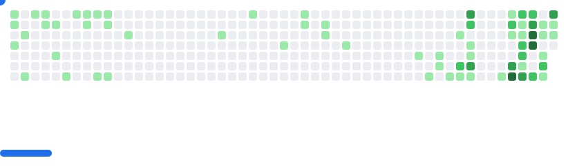

  <picture>
    <source media="(prefers-color-scheme: dark)" srcset="images/header-dark.svg" />
    <source media="(prefers-color-scheme: light)" srcset="images/header-light.svg" />
    
  </picture>

 

  <picture>
    <source media="(prefers-color-scheme: dark)" srcset="images/tree-dark.svg" />
    <source media="(prefers-color-scheme: light)" srcset="images/tree-light.svg" />
    
  </picture>

 

  <picture>
    <source media="(prefers-color-scheme: dark)" srcset="images/breakout-dark.svg" />
    <source media="(prefers-color-scheme: light)" srcset="images/breakout-light.svg" />
    
  </picture>

  <picture>
    <source media="(prefers-color-scheme: dark)" srcset="images/wave-dark.svg" />
    <source media="(prefers-color-scheme: light)" srcset="images/wave-light.svg" />
    
  </picture>
   
  rendered by <code>.github/scripts/render.py</code> · stats &amp; breakout refresh nightly

